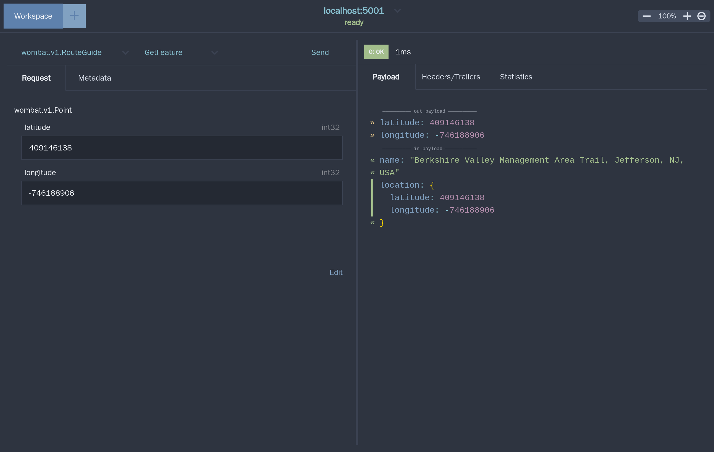

<h3 align="center">Cross platform gRPC client</h3>

## Features

- Automatic parsing of proto definitions to render services and input messages
- `.proto` file discovery
- Selection of multiple services and methods
- Configuration of TLS, including disabling TLS (plain text)
- Input generation for all scalar types
- Input generation for nested messages
- Input generation for enums, including nested
- Input generation for repeated fields
- Input generation for oneof and map fields
- Support for adding RPC metadata
- Execute unary requests
- Execute server streaming requests
- Execute client streaming requests
- Execute bidirectional requests
- Cancel requests in-flight
- Send EOF for client streaming and bi-directional streaming
- View response messages
- View RPC Header and Trailer
- View full RPC statistics
- MacOS build
- Linux build
- Windows build
- Reflection API to determine RPC schema
- Support for Google Well Known Types
- Create multiple workspaces and workspace switching

## Download

This is a fork of [rogchap/wombat](https://github.com/rogchap/wombat), updated to Wails v2. Visit the
[Releases](https://github.com/Myrception/wombat/releases) page for the latest downloads.

## Install

### MacOS

[Download](https://github.com/Myrception/wombat/releases) and open `Wombat_*_Darwin_universal.dmg` (Intel and Apple Silicon), drag `Wombat.app` to the
`Applications` folder and run from `Applications`.

The app is not signed. If you get this error message: `"Wombat.app" can't be opened because the identity of the
developer cannot be confirmed.`, install by **Right Click/Option Click** -> **Open** -> **Open**. You'll only need to
do this on first install.

### Linux

[Download](https://github.com/Myrception/wombat/releases), unarchive `Wombat_*_Linux_x86_64.tar.gz` and run `wombat`.

Wombat needs GTK 3 and WebKitGTK 4.1, e.g. `sudo apt install libgtk-3-0 libwebkit2gtk-4.1-0` on Debian/Ubuntu or
`sudo pacman -S gtk3 webkit2gtk-4.1` on Arch.

### Windows

[Download](https://github.com/Myrception/wombat/releases), unarchive `Wombat_*_Windows_x86_64.zip` and run `wombat.exe`. Wombat uses the Microsoft Edge
WebView2 runtime, which is part of Windows 10 and 11.
